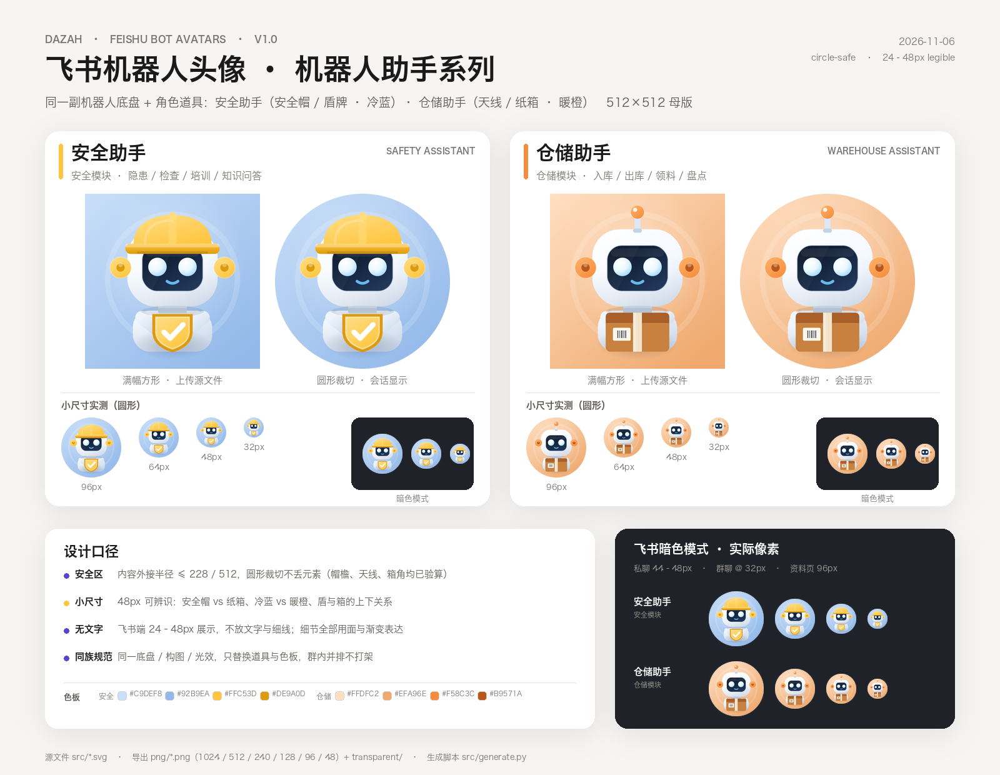
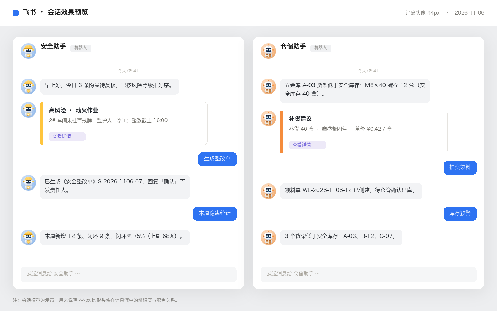

# 飞书机器人头像 · 机器人助手系列

> 安全助手 / 仓储助手　·　2026-11-06　·　v1.0

同一副机器人底盘（白色软壳 + 深蓝面屏 + 两侧彩色耳罩），用「角色道具 + 色板」区分两个业务机器人：

| | 安全助手 | 仓储助手 |
|---|---|---|
| 角色道具 | 黄色安全帽 + 胸前盾牌（✓） | 橙色信号天线 + 手捧纸箱（面单条码） |
| 背景 | 冷蓝（巡查 / 安全） | 暖橙（纸箱 / 库房） |
| 对应应用 | 安全模块飞书应用（`SAFETY_FEISHU_*`） | 仓储飞书应用（`WAREHOUSE_FEISHU_*`） |





---

## 文件清单

| 路径 | 内容 |
|---|---|
| `png/safety-assistant-{1024,512,240,128,96,48}.png` | 安全助手头像导出 |
| `png/warehouse-assistant-{1024,512,240,128,96,48}.png` | 仓储助手头像导出 |
| `png/transparent/*-transparent-1024.png` | 透明底版本（自定义底色 / Web 端复用） |
| `src/safety-assistant.svg`、`src/warehouse-assistant.svg` | 矢量源文件（512 画布） |
| `src/generate.py` | 头像生成脚本（改色板 / 道具后一键重出全部尺寸） |
| `src/preview.py` | 评审板与会话效果图生成脚本 |
| `preview/contact-sheet.png` | 评审板：方形 / 圆形 / 小尺寸 / 暗色模式 / 色板 |
| `preview/chat-mock.png` | 飞书会话中 44px 头像的显示效果示意 |

**上传用哪张**：飞书后台一般用 `*-512.png`（要求不高时 `*-1024.png` 更稳，PNG 均 < 200 KB）。

## 在飞书里替换头像

1. 打开[飞书开放平台 · 开发者后台](https://open.feishu.cn/app)，选择安全模块对应的应用。
2. 在「应用信息 → 应用图标」与「机器人 → 头像」两处，上传 `png/safety-assistant-512.png`。
3. 选择仓储应用，同样上传 `png/warehouse-assistant-512.png`。
4. 保存并发布新版本；客户端通常几分钟内刷新，必要时重启飞书。
5. 会话内头像按圆形裁切显示——本套设计已按圆形安全区校验，不会切到帽檐、天线或箱角。

> 若机器人头像在「凭证与基础信息 / 机器人」中分开配置，两处都换成同一张即可。

## 设计口径

- **画布**：512 × 512 正方形，满幅背景，兼容飞书的圆形裁切与设置页方形展示。
- **圆形安全区**：所有内容外接半径 ≤ 228 / 512（内切圆半径的 89%），帽檐、天线球、箱角均已验算。
- **小尺寸**：48px 时靠「安全帽 vs 纸箱」+「冷蓝 vs 暖橙」+「盾/箱位置」三要素区分；24–32px 仍保留主色与道具轮廓。
- **无文字无细线**：所有细节用面、渐变与色块表达，避免缩放糊成一团。
- **成对原则**：同一底盘、构图、光效与背景语言，只替换角色道具与色板，两个机器人在群成员列表中并排出现也不打架。
- **共用细节**：面屏（#0A1526 → #22395C）、发光眼、微笑、耳罩、底面投影；背景统一为「斜向渐变 + 中心柔光 + 一枚极淡同心圆环」。

## 色板

| 用途 | 安全助手 | 仓储助手 |
|---|---|---|
| 背景（浅 → 深） | `#C9DEF8` → `#92B9EA` | `#FFDFC2` → `#EFA96E` |
| 主色 | `#FFC53D`（安全帽黄） | `#F58C3C`（仓储橙） |
| 主色浅 / 深 | `#FFDC80` / `#DE9A0D` | `#FFB067` / `#B9571A` |
| 共用外壳 | `#FFFFFF` → `#DCE7F4` | 同左 |
| 共用面屏 | `#0A1526` → `#22395C` | 同左 |
| 道具专属 | 盾牌底 `#DE9A0D`、钩 `#FFFFFF` | 箱体 `#C8813F`、箱盖 `#A95F29`、胶带 `#F4E3CA` |

色板与 `frontend/src/app/globals.css` 中的品牌中性色、语义色无冲突；主色仅用于头像，不参与 UI 语义。

## 重新生成

```bash
cd docs/assets/feishu-bot-avatars/src

# 一次性准备环境（cairosvg 负责 SVG→PNG，Pillow 负责评审图）
python3 -m venv /tmp/avatar-venv
/tmp/avatar-venv/bin/pip install cairosvg pillow

/tmp/avatar-venv/bin/python generate.py   # 输出 SVG 与全部 PNG 尺寸
/tmp/avatar-venv/bin/python preview.py    # 输出 preview/ 评审图
```

- 改角色：`generate.py` 顶部的 `BOTS` 调色板 + `svg_safety_prop()` / `svg_warehouse_prop()`。
- 改底盘：`svg_chassis()`（头 / 面屏 / 眼睛 / 耳罩 / 肩颈几何都在这里，两个机器人共用）。
- 改导出尺寸：`SIZES`。
- 评审图字体依赖 macOS 的 Hiragino Sans GB，缺失时自动回退到 Arial Unicode；仅影响评审图，不影响头像本身。

## 备注

- 本目录是 2026-11-06 交付的「机器人助手」系列；`docs/assets/avatars/` 下 10-29 的企鹅 A/B 方案继续留存存档，未删除。
- 透明底版本里的道具投影为半透明深蓝，用于贴合自定义背景；如果放到纯白页面觉得有灰边，可改用带背景的常规 PNG。
- 头像不含「安全 / 仓储」文字角标：飞书会在头像旁显示机器人名称，文字进入头像只会在小尺寸下变糊。
